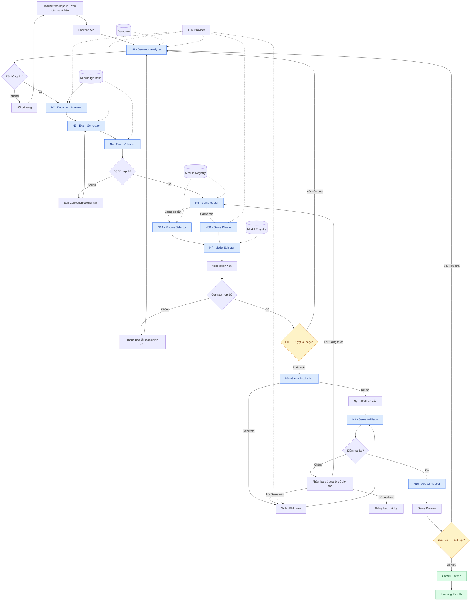

# AI SPEC — [Tên lát cắt] · Nhóm [tên nhóm] · Phòng [XXX] · Zone [X]

> Mốc nộp: §7 chốt chuẩn "đạt" tại **CP2 19:30 Thứ Sáu 27/11** · §0–§7 nộp **CP3 10:00 Thứ Bảy 28/11** · đủ §0–§10 **CP4 14:30 Thứ Bảy 28/11** · §10 changelog ghi tiếp đến **23:59 Thứ Bảy 28/11**.
> Đầu mỗi mục ghi bước guide (`02-guide.md` trong repo đề) chỉ cách điền. Mỗi mục ngắn, có số và nguồn; chi tiết để ở file được trỏ tới. Xoá dòng hướng dẫn trong ngoặc vuông khi điền xong.

Track: [ ] A · [ ] B · [ ] C · [ ] D · [ ] E — bài toán: [đề gợi ý trong file track, hoặc bài toán nhóm tự mở rộng] __
Data BTC cấp đã dùng (nếu có — không commit nguyên file): __

## §0. Hiện tại việc này diễn ra thế nào *(guide 1.1)*
- Luồng hiện tại của việc này, trong khoá hoặc trên app thật (3–5 bước; ảnh chụp từ tài khoản của mình, đã che thông tin):
- Công cụ / AI đang được dùng cho việc này (nếu có) + nguồn. Không kiểm được thì ghi "chưa kiểm":

## §1. Người dùng & bằng chứng *(guide 1.1, 1.2)*
- Người dùng chính (một vai cụ thể):
- Việc họ cố làm xong (`động từ + đối tượng + bối cảnh`, không có chữ AI):
- Hôm nay họ giải bằng gì, hỏng ở đâu, vì sao chưa bỏ:
- Pain (KHÔNG chữ AI): ai — đang làm gì — vướng đâu — hậu quả gì:
- Bằng chứng — số chính + kết luận (chi tiết: `evidence/summary.md`): __

## §2. Impact & quyết định chọn *(guide 1.3)*

| Hướng | Bao nhiêu người gặp | Bao nhiêu lần / tháng | Mỗi lần tốn gì | Impact / tháng | Làm kịp không | Chọn? |
|---|---|---|---|---|---|---|
|  |  |  |  |  |  |  |
|  |  |  |  |  |  |  |
|  |  |  |  |  |  |  |

- **Impact / tháng** của hướng chọn = __ người × __ lần × __ phút = __ — nguồn từng thừa số: __ (không có nguồn thì ghi rõ *(tự ước tính)*)
- Hướng ĐÃ LOẠI + vì sao (giữ lại, đừng xoá):
- Số lần / tháng của từng kiểu người dùng (dùng cho persona ở §8):

## §3. Giải pháp tương tự *(guide 2.1)*
- [sản phẩm / tính năng gần giống]: một điều đáng học · một điều đáng né · mình khác gì

## §4. Thiết kế *(guide 2.2, 3.2)*

### Lát cắt MỘT CÂU

Giáo viên cung cấp yêu cầu, tài liệu hoặc bộ đề thông qua Chatbot; AI phân tích nội dung, lựa chọn hoặc tạo Game học tập phù hợp, lựa chọn mô hình AI tương tác và chuẩn bị ứng dụng Game để giáo viên kiểm tra, phê duyệt và sử dụng.

### Không làm

- Không huấn luyện mô hình AI tương tác từ đầu.
- Không sinh HTML mới khi giáo viên lựa chọn Game có sẵn tương thích.
- Không thay đổi mã nguồn gốc của Game có sẵn.
- Không tự tạo kiến thức hoặc đáp án thiếu căn cứ.
- Không tự động phát hành Game khi chưa được giáo viên phê duyệt.
- Không bắt buộc người chơi sử dụng Camera hoặc Model AI.
- Không cho phép mã nguồn Game truy cập trái phép dữ liệu và tài nguyên hệ thống.
- Không viết cứng câu hỏi và đáp án vào mã nguồn HTML.

### Sơ đồ kiến trúc



Sơ đồ trên mô tả kiến trúc mục tiêu của hệ thống. Tại CP2, Mock Agent được sử dụng để giả lập đầu ra ApplicationPlan, giúp các thành viên phát triển và tích hợp song song mà không cần chờ LLM thật.

### Hình dạng kiến trúc

- [x] Workflow cố định.
- [ ] Một Agent.
- [ ] Nhiều Agent.

**Kiến trúc lựa chọn:** Conditional AI Workflow – Luồng xử lý AI có điều kiện phân nhánh.

Hệ thống sử dụng các Node có chức năng, dữ liệu đầu vào, dữ liệu đầu ra và điều kiện chuyển bước được xác định trước.

LLM đảm nhiệm các công việc cần khả năng hiểu ngôn ngữ, phân tích kiến thức, tạo câu hỏi, thiết kế Game và sinh mã nguồn. Các thao tác truy xuất dữ liệu, điều hướng, kiểm tra cấu trúc, kiểm tra tương thích và lắp ghép ứng dụng được thực hiện bằng logic lập trình.

Lựa chọn Workflow vì quy trình tạo Game có các bước xử lý tương đối rõ ràng, cần kiểm soát chặt chẽ chất lượng nội dung giáo dục và khả năng tích hợp giữa các thành phần. Kiến trúc này giúp giảm độ phức tạp, kiểm soát chi phí gọi LLM, dễ kiểm thử và phù hợp với thời gian Hackathon.

Chưa sử dụng Single Agent hoặc Multi-Agent vì chưa cần trao quyền cho AI tự quyết định toàn bộ trình tự xử lý hoặc điều phối nhiều tác nhân độc lập.

### AI Pipeline

| Node | Chức năng | Input | Output |
|---|---|---|---|
| N1 – Semantic Analyzer | Phân tích yêu cầu và lịch sử hội thoại | Tin nhắn, lịch sử | Structured Requirements |
| N2 – Document Analyzer | Phân tích tài liệu giáo viên | Tài liệu, bài giảng, bộ đề | Knowledge Data |
| N3 – Exam Generator | Trích xuất hoặc tạo câu hỏi và đáp án | Yêu cầu, kiến thức | Exam JSON |
| N4 – Exam Validator | Kiểm chứng nội dung bộ đề | Exam, tài liệu nguồn | Validation Result |
| N5 – Game Router | Quyết định sử dụng Game có sẵn hoặc tạo Game mới | Yêu cầu, bộ đề, danh mục Game | Generation Mode |
| N6A – Module Selector | Lựa chọn Game có sẵn | Module Registry, yêu cầu | Player ID, Manifest |
| N6B – Game Planner | Thiết kế cơ chế Game mới | Yêu cầu, bộ đề | Game Plan |
| N7 – Model Selector | Lựa chọn Model AI tương tác | Game Plan hoặc Manifest, Model Registry | Model ID, Mapping, Configuration |
| N8 – Game Production | Nạp HTML có sẵn hoặc sinh HTML mới | ApplicationPlan đã duyệt, Contract | Player |
| N9 – Game Validator | Kiểm tra mã nguồn và khả năng tích hợp | Player, Model, Exam | Validation Result |
| N10 – App Composer | Lắp ghép ứng dụng Game | Player ID, Model ID, Exam ID | App Preview |

### Cơ chế điều hướng Game

Hệ thống hỗ trợ hai chế độ tạo Game.

**Nhánh A – reuse_existing (tái sử dụng Game có sẵn):**

- Truy xuất Game mà giáo viên lựa chọn.
- Kiểm tra khả năng tiếp nhận bộ đề và tương thích với Model AI.
- Sử dụng Player ID và mã nguồn HTML hiện có.
- Không gọi LLM để sinh HTML mới.
- Không tạo thêm Player khi không cần thiết.
- Không thay đổi mã nguồn Game gốc.
- Kết hợp Game với Model và bộ đề phù hợp.

**Nhánh B – generate_new (tạo Game mới):**

- Phân tích yêu cầu giáo viên.
- Thiết kế cơ chế chơi, luật chơi và cách tính điểm.
- Lựa chọn phương thức tương tác phù hợp.
- Sinh HTML, CSS và JavaScript theo Contract của trình chơi.
- Kiểm tra mã nguồn và khả năng thực thi.
- Kết hợp Player mới với Model và bộ đề.

Nếu giáo viên chỉ yêu cầu thay đổi bộ đề, hệ thống ưu tiên giữ nguyên Player hiện có khi vẫn tương thích.

Nếu Game được lựa chọn không tương thích, AI phải thông báo nguyên nhân và đề xuất phương án thay thế, không tự ý thay đổi lựa chọn của giáo viên.

### AI dựa vào đâu

AI sử dụng các nguồn dữ liệu sau:

| Nguồn dữ liệu | Mục đích |
|---|---|
| Teacher Requirements | Yêu cầu, mục tiêu học tập và thể loại Game |
| Conversation History | Duy trì ngữ cảnh hội thoại |
| Teacher Documents | Trích xuất kiến thức và câu hỏi |
| Knowledge Base | Tạo và kiểm chứng nội dung học tập |
| Module Registry | Tra cứu Game có sẵn và khả năng tương thích |
| Model Registry | Tra cứu Model AI, đầu vào, đầu ra và nhãn nhận diện |
| Exam Registry | Tra cứu bộ đề có sẵn |
| Integration Contract | Đảm bảo khả năng tích hợp Player, Model và Exam |

AI chỉ được truy cập dữ liệu thuộc phạm vi yêu cầu và quyền sử dụng của giáo viên. Không được truy cập thông tin bí mật, tài liệu ngoài phạm vi hoặc dữ liệu riêng tư của người dùng khác.

### Danh sách công cụ

| Công cụ | Input | Output | Tác động ra ngoài? | Trạng thái |
|---|---|---|---|---|
| check_game | HTML | Kết quả kiểm tra và cảnh báo | Không | Có trong bộ khung hiện tại |
| read_document | Tài liệu | Văn bản và nguồn tham chiếu | Đọc dữ liệu | Thiết kế |
| retrieve_knowledge | Chủ đề, truy vấn | Kiến thức liên quan | Đọc dữ liệu | Thiết kế |
| list_players | Điều kiện tìm kiếm | Danh sách Game | Đọc dữ liệu | Thiết kế |
| get_player | Player ID | HTML và Manifest | Đọc dữ liệu | Thiết kế |
| list_models | Loại Model | Danh sách Model AI | Đọc dữ liệu | Thiết kế |
| validate_exam | Bộ đề, tài liệu nguồn | Kết quả kiểm chứng | Không | Thiết kế |
| validate_application_plan | ApplicationPlan | Kết quả kiểm tra Contract | Không | Phạm vi T06 |
| validate_compatibility | Player, Model, Exam | Kết quả tương thích | Không | Thiết kế |
| test_game | Player, Model, Exam | Kết quả kiểm thử | Thực thi cách ly | Thiết kế |

Danh sách công cụ thực tế phải được đồng bộ với mã nguồn. Các công cụ ở trạng thái thiết kế không được xem là đã triển khai hoặc đã đăng ký cho Agent sử dụng.

### ApplicationPlan Contract – T06

ApplicationPlan là hợp đồng dữ liệu giữa AI Chatbot và các thành phần khác của hệ thống.

Mục tiêu của Contract là chuẩn hóa đầu ra AI để Frontend, Backend và Data & Eval có thể phát triển song song mà không cần chờ Real Agent.

**Input của Agent:**

| Trường | Kiểu dữ liệu | Mô tả |
|---|---|---|
| session_id | string | Mã phiên hội thoại |
| message | string | Yêu cầu của giáo viên |
| history | array | Lịch sử hội thoại |
| document_ids | array | Danh sách tài liệu được cung cấp |
| selected_player_id | integer hoặc null | Game được giáo viên lựa chọn |
| selected_model_id | integer hoặc null | Model AI được lựa chọn |
| selected_exam_id | integer hoặc null | Bộ đề được lựa chọn |
| generation_mode | string hoặc null | Chế độ sử dụng Game có sẵn hoặc tạo mới |

**Output của Agent:**

| Trường | Kiểu dữ liệu | Mô tả |
|---|---|---|
| schema_version | string | Phiên bản Contract |
| simulated | boolean | Phân biệt Mock Agent và Real Agent |
| status | string | Trạng thái xử lý |
| message | string | Phản hồi cho giáo viên |
| application_plan | object hoặc null | Kế hoạch ứng dụng Game |
| errors | array | Danh sách lỗi |

**ApplicationPlan gồm các thành phần:**

| Thành phần | Mô tả |
|---|---|
| name | Tên ứng dụng Game |
| player | Trình chơi có sẵn hoặc mã nguồn Game mới |
| model | Model AI và cấu hình nhận diện |
| exam | Bộ đề có sẵn hoặc bộ đề mới |
| interaction | Phương thức tương tác chính và chuột dự phòng |

**Ví dụ dữ liệu ApplicationPlan:**

```json
{
  "schema_version": "1.0",
  "simulated": true,
  "status": "pending_approval",
  "message": "Da chuan bi ke hoach Game hoc Toan.",
  "application_plan": {
    "name": "Game hoc Toan lop 5",
    "player": {
      "mode": "reuse_existing",
      "player_id": 1,
      "html": null
    },
    "model": {
      "model_id": 2,
      "kind": "hands",
      "mapping": {
        "grab": "fist"
      },
      "sure": 0.8,
      "hold_ms": 800
    },
    "exam": {
      "mode": "generate_new",
      "exam_id": null,
      "content": "5 + 7 bang bao nhieu? | 12 | 13 | =A"
    },
    "interaction": {
      "primary": "hands",
      "fallback": "mouse",
      "mouse_always_enabled": true
    }
  },
  "errors": []
}
```

Các ID, nhãn nhận diện và cấu hình trong ví dụ chỉ mang tính minh họa. Khi tích hợp phải sử dụng dữ liệu thực tế được hệ thống cung cấp.

**Quy tắc kiểm tra Contract:**

- Chế độ reuse_existing phải có Player ID hợp lệ và không chứa HTML mới.
- Chế độ generate_new phải có HTML hợp lệ trước khi bàn giao Player hoàn chỉnh.
- Exam có sẵn phải có Exam ID.
- Exam mới phải chứa nội dung đúng định dạng bộ đề.
- Model ID và Mapping phải tương thích với Player.
- Không tự tạo ID tài nguyên không tồn tại.
- Luôn có phương thức điều khiển bằng chuột.
- ApplicationPlan không hợp lệ không được chuyển sang trạng thái chờ phê duyệt.
- ApplicationPlan không thay thế trạng thái phê duyệt và quyền truy cập được quản lý bởi Backend.

Cấu trúc Contract trên là đề xuất phiên bản 1.0, cần được các thành viên thống nhất và đối chiếu với Contract thực tế của Repository trước khi sử dụng chung.

### Mock Agent – T06

Mock Agent là phiên bản AI giả lập được xây dựng để trả về ApplicationPlan theo Contract mà không cần gọi LLM thật.

**Mục đích:**

- Giúp Frontend phát triển giao diện hiển thị kết quả AI.
- Giúp Backend phát triển chức năng tích hợp Player, Model và Exam.
- Giúp Data & Eval xây dựng bộ kiểm thử.
- Giảm phụ thuộc giữa các thành viên.
- Đảm bảo T06 không phải chờ T12.

Mock Agent và Real Agent sử dụng cùng Input/Output Contract.

Mock Agent hỗ trợ tối thiểu bốn tình huống:

| Tình huống | Kết quả |
|---|---|
| Giáo viên chọn Game có sẵn | Trả Player ID, không sinh HTML mới |
| Giáo viên yêu cầu Game mới | Trả HTML từ khuôn mẫu giả lập |
| Giáo viên cung cấp thiếu thông tin | Trả needs_clarification |
| Dữ liệu hoặc tài nguyên không hợp lệ | Trả error |

Mock Agent không yêu cầu API Key và không gọi LLM thật. Kết quả giả lập phải được đánh dấu simulated=true.

**Tiêu chí nghiệm thu T06:**

- ApplicationPlan Contract được thống nhất giữa các thành viên.
- Mock Agent trả dữ liệu đúng Contract.
- Mock Agent hoạt động độc lập với Real Agent và T12.
- Hỗ trợ nhánh Game có sẵn và Game mới.
- Không sinh HTML khi sử dụng Game có sẵn.
- Có cấu hình Model và chuột dự phòng.
- Có kiểm thử và tài liệu hướng dẫn tích hợp.

### Model AI tương tác

Cần phân biệt LLM dùng để tạo Game với Model AI dùng để nhận diện hành động của người chơi.

| Model Kind | Input | Output |
|---|---|---|
| hands | Hình ảnh từ Camera | Tọa độ bàn tay hoặc trạng thái cử chỉ |
| image | Hình ảnh từ Camera | Nhãn nhận diện và độ tin cậy |
| pose | Hình ảnh từ Camera | Tư thế hoặc nhãn nhận diện |
| audio | Âm thanh từ Microphone | Kết quả nhận diện âm thanh nếu Runtime hỗ trợ |
| mouse | Thao tác chuột | Tọa độ và sự kiện nhấn |

Model Selector phải lựa chọn Model dựa trên danh mục thực tế và khả năng của Game Runtime.

Không đề xuất Model âm thanh như một chức năng đã hoạt động nếu Runtime chưa hỗ trợ.

### Mouse Fallback – Cơ chế điều khiển dự phòng

Mọi Game được nghiệm thu phải có khả năng điều khiển bằng chuột độc lập với Model AI.

Chuột phải hoạt động trong các trường hợp:

- Model chưa được tải.
- Model đang tải.
- Model gặp lỗi.
- Camera không hoạt động.
- Người dùng từ chối quyền Camera.
- Người dùng chủ động không sử dụng Model AI.

Việc chuyển sang điều khiển bằng chuột không được làm mất điểm hoặc tiến độ chơi.

### Mức tự động

- [x] AI gợi ý, người quyết.
- [ ] AI tự làm khi chắc, chuyển người khi không.
- [ ] AI tự làm.

AI tự động phân tích yêu cầu, tạo bộ đề, đề xuất Game, lựa chọn Model tương tác, chuẩn bị ApplicationPlan và kiểm tra kết quả trong phạm vi được cấp quyền.

Giáo viên có quyền kiểm tra, chỉnh sửa, chấp nhận hoặc từ chối kết quả trước khi phát hành.

Lựa chọn mức tự động này vì kiến thức hoặc đáp án sai có thể ảnh hưởng trực tiếp đến quá trình học tập của học sinh. Cơ chế phê duyệt giúp hạn chế rủi ro và tăng khả năng kiểm soát của giáo viên.

### Chỗ chặn rủi ro

| Rủi ro | Vị trí kiểm soát | Cách xử lý |
|---|---|---|
| AI hiểu sai yêu cầu | N1 | Hỏi bổ sung hoặc xác nhận lại |
| Tài liệu không đủ kiến thức | N2 | Thông báo thiếu nguồn dữ liệu |
| AI sinh kiến thức sai | N3, N4 | Đối chiếu tài liệu nguồn |
| AI sinh đáp án sai | N4 | Kiểm chứng và yêu cầu sửa |
| Game không tương thích | N5, N6A | Kiểm tra Module Registry |
| Model không tương thích | N7 | Kiểm tra Model Registry và Mapping |
| ApplicationPlan sai cấu trúc | Contract Validator | Từ chối dữ liệu không hợp lệ |
| Sinh HTML không cần thiết | N5, N8 | Bỏ qua nhánh sinh mã nguồn |
| HTML không hợp lệ | N8, N9 | Kiểm tra Contract |
| HTML chứa hành vi không an toàn | N9 | Phân tích mã nguồn, giới hạn quyền và sandbox |
| Model chưa tải hoặc bị lỗi | Game Runtime | Điều khiển bằng chuột |
| AI sửa lỗi không giới hạn | Self-Correction | Giới hạn số lần Retry |
| Phát hành chưa được duyệt | HITL | Chặn phát hành |

Rủi ro quan trọng nhất là AI tạo câu hỏi hoặc đáp án sai nhưng vẫn được đưa vào Game. Hệ thống kiểm soát rủi ro này bằng kiểm chứng tài liệu nguồn, kiểm tra bộ đề và phê duyệt của giáo viên.

### Self-Correction – Cơ chế tự sửa lỗi

Khi kết quả kiểm chứng không đạt yêu cầu, Workflow phân loại lỗi và quay lại Node tương ứng.

| Loại lỗi | Thành phần xử lý lại |
|---|---|
| Sai yêu cầu giáo viên | Semantic Analyzer |
| Sai kiến thức tài liệu | Document Analyzer |
| Sai câu hỏi hoặc đáp án | Exam Generator |
| Game không phù hợp | Game Router |
| Model không tương thích | Model Selector |
| HTML không hợp lệ | Game Production |
| ApplicationPlan không hợp lệ | Thành phần tạo ApplicationPlan |

Sau mỗi lần sửa, hệ thống phải thực hiện kiểm chứng lại.

Đối với sinh HTML, giới hạn tối đa hai lượt sinh, bao gồm một lượt ban đầu và một lượt sửa lỗi.

Các vòng sửa bộ đề và lựa chọn tài nguyên cũng phải có giới hạn. Nếu không thể tạo kết quả hợp lệ trong phạm vi cho phép, hệ thống dừng và thông báo nguyên nhân cho giáo viên.

### Chỗ người duyệt – HITL

HITL (Human-in-the-Loop) được thiết kế tại hai điểm:

**Điểm 1 – Duyệt ApplicationPlan:**

- Kiểm tra yêu cầu giáo viên.
- Kiểm tra nội dung bộ đề và đáp án.
- Kiểm tra Game được lựa chọn.
- Kiểm tra Model và phương thức tương tác.
- Chấp nhận hoặc yêu cầu chỉnh sửa kế hoạch.

**Điểm 2 – Duyệt Game Preview:**

- Kiểm tra giao diện và cơ chế chơi.
- Kiểm tra khả năng tiếp nhận bộ đề.
- Kiểm tra Model AI tương tác.
- Kiểm tra điều khiển bằng chuột.
- Xác nhận phát hành Game.

Khi giáo viên yêu cầu chỉnh sửa, hệ thống chỉ xử lý lại những thành phần liên quan và kiểm chứng lại kết quả.

AI không được tự động bỏ qua bước phê duyệt.

### Nguyên tắc thiết kế HAX

| Nguyên tắc | Cách áp dụng |
|---|---|
| G1 – Làm rõ AI có thể làm gì | Chatbot giới thiệu khả năng tạo bộ đề, lựa chọn và tạo Game |
| G2 – Làm rõ AI làm tốt đến đâu | Thông báo giới hạn kiến thức, khả năng sinh mã nguồn và Model tương tác |
| G8 – Hỗ trợ bỏ qua AI dễ dàng | Cho phép điều khiển Game bằng chuột thay cho Model AI |
| G9 – Hỗ trợ sửa lỗi dễ dàng | Giáo viên có thể chỉnh sửa bộ đề, Game và cấu hình thông qua Chatbot |
| G10 – Thu hẹp phạm vi khi không chắc chắn | AI hỏi bổ sung, yêu cầu tài liệu hoặc từ chối tạo nội dung thiếu căn cứ |
| G11 – Giải thích lý do | AI giải thích lựa chọn Game, Model và nguyên nhân không tương thích |

Đặc biệt, G10 được áp dụng tại Semantic Analyzer, Document Analyzer, Exam Validator, Game Router và Model Selector.

Khi không đủ dữ liệu hoặc không xác định được phương án tương thích, AI không tự bịa thông tin để tiếp tục xử lý.

### Phần nào còn giả

Tại CP2, phạm vi của AI Engineer tập trung vào thiết kế kiến trúc, ApplicationPlan Contract và Mock Agent theo nhiệm vụ T06.

Các chức năng có thể sử dụng dữ liệu giả lập tại CP2:

| Thành phần | Phương pháp giả lập |
|---|---|
| Semantic Analyzer | Trả yêu cầu có cấu trúc từ dữ liệu mẫu |
| Document Analyzer | Sử dụng nội dung tài liệu mẫu |
| Exam Generator | Trả bộ đề mẫu đúng định dạng |
| Game Router | Phân nhánh theo điều kiện lập trình |
| Model Selector | Sử dụng danh mục Model mẫu hoặc dữ liệu được cung cấp |
| Game Production | Nạp Game có sẵn hoặc sử dụng HTML mẫu |
| ApplicationPlan | Trả dữ liệu theo Contract thống nhất |


## §4. Thiết kế *(guide 2.2, 3.2)*
- **Lát cắt MỘT CÂU** (1 người dùng · 1 việc · 1 quyết định AI · 1 kết quả):
- Không làm (≥3 điều):
- **Sơ đồ** (ảnh / Mermaid / draw.io): [chèn ở đây]
- **Hình dạng:** [ ] workflow cố định · [ ] một agent · [ ] nhiều agent — 2 dòng lý do, và vì sao **không** chọn hình dạng phức tạp hơn:
- **AI dựa vào đâu** — mỗi công cụ (khớp `codebase/tools.py`):

  | Công cụ | Input | Output | Tác động ra ngoài? |
  |---|---|---|---|
  |  |  |  |  |

- **Mức tự động:** [ ] AI gợi ý, người quyết · [ ] AI tự làm khi chắc, chuyển người khi không · [ ] AI tự làm — lý do (sai thì ai chịu gì, sửa đắt hay rẻ):
- **Chỗ chặn rủi ro** (rủi ro lớn nhất của lát cắt bị chặn ở đâu, bằng gì):
- **Chỗ người duyệt** (việc AI không được tự làm):
- **Nguyên tắc thiết kế** (≥3, bắt buộc G10):

  | Nguyên tắc | Chỗ cụ thể trên sơ đồ / trong bản chạy thử |
  |---|---|
  | G10 — thu hẹp phạm vi khi không chắc |  |
  |  |  |
  |  |  |

- Phần nào còn giả (công cụ trả dữ liệu giả, model chế độ giả…) — ghi rõ, không giả làm thật:


## §5. Chỗ khó — 4 lớp + ≥6 kịch bản + 2 tấn công *(guide 2.3)*

| Kịch bản | Lớp (1–4) | Hành vi mong muốn (nói gì, hiện gì, cho làm gì tiếp) | Câu thử |
|---|---|---|---|
|  |  |  |  |
| *(tấn công)* |  |  |  |
| *(tấn công)* |  |  |  |

(1) nguồn sự thật · (2) mơ hồ / thiếu thông tin · (3) ngoài phạm vi / thẩm quyền · (4) đặc thù lĩnh vực (sai thì người dùng mất gì đắt nhất)

## §6. Bốn đường đi của trải nghiệm
- Mọi thứ suôn sẻ: · Không chắc (lớp 2): · Không có căn cứ (lớp 1): · Người dùng sửa:
- Bị đòi ngoài phạm vi (lớp 3): · Trường hợp đặc thù lĩnh vực (lớp 4):

## §7. Đánh giá & chuẩn "đạt" *(guide 2.4, 4.1)*
- Data card: `data/DATA_CARD.md` (3 dataset: Catalog 17 mục / 90 câu / 8 ảnh) · bộ câu thử: `eval/benchmark.csv` — 12 câu (thuong 3 · kho 7 · tu_choi 2) · metric: `eval/metric_spec.yaml` (4 metric) — bản CP2, chờ TV1 bổ sung ≥1/3 câu từ nguồn thật.
- **Chuẩn "đạt" (đề xuất TV4 27/11/2026 — cần nhóm chốt trước 19:30; giữ nguyên sau đó):** "Đạt khi ≥80% câu qua (tối thiểu 10/12 ở bản CP2), và 100% câu `tu_choi` qua, và 0 tên Catalog bịa."
- Kết quả: chưa chạy — lượt 1 __/__ (__%) · lượt 2 __/__ (__%) — run ID: __ / __ → chi tiết `eval/report.md`, hồ sơ `eval/README.md`

## §8. Chi phí khi dùng thật *(guide 4.2)*
- Persona + giá: `cost/personas.yaml` · lượt mô phỏng: `cost/simulate-__.csv` (__ phiên)
- Chi phí / task thành công: __ (model __) · __ (model __)
- Chi phí / tháng ở quy mô thật: thấp __ · cơ sở __ · cao __ → chi tiết `cost/cost-estimate.md`
- So với impact / người / tháng (§2): đáng làm không, vì sao:

## §9. Rủi ro & an toàn
- Dữ liệu: đã ẩn danh gì, không thu gì, không đưa gì vào model gói miễn phí:
- AI **không được** làm gì kể cả khi người dùng yêu cầu:
- Ai có thể bị hại nếu AI sai, và nhóm chặn thế nào:

## §10. Phân công & changelog
- Phân công có tên (theo chặng, chia cặp — guide "Cách chia việc"): __
- Dùng AI vào việc gì (2–3 dòng; chi tiết `docs/ai-usage.md`):
- Nhật ký thay đổi — **mọi thay đổi sau CP2 19:30 Thứ Sáu 27/11 phải có dòng ở đây**:

**CP2 → CP4** (vd thu hẹp lát cắt, hỏi thêm người dùng, lần cải tiến trước lượt 2)

| Thời điểm | Đổi gì | Vì sao (trỏ về câu thử / lỗi / bằng chứng nào) |
|---|---|---|
|  |  |  |

**Sau CP4 (đến 23:59 Thứ Bảy 28/11)** (sửa theo góp ý — không sửa chuẩn "đạt", câu thử, số bằng chứng, kết quả các lượt đã chạy)

| Thời điểm | Đổi gì | Vì sao |
|---|---|---|
|  |  |  |
