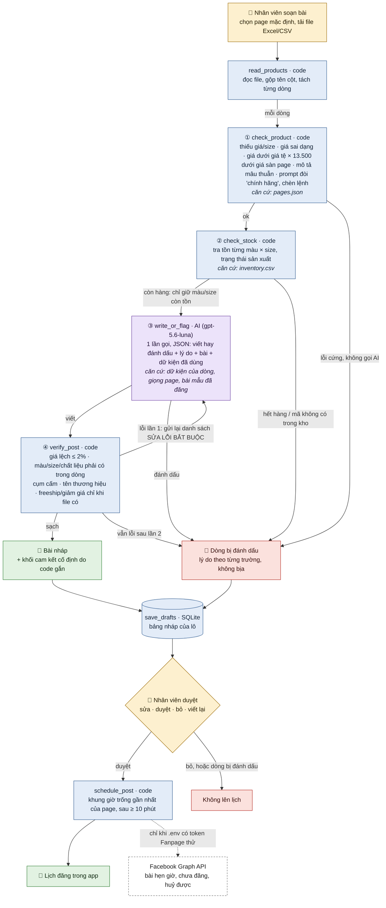

# AI SPEC — [Tên lát cắt] · Nhóm [tên nhóm] · Phòng [XXX] · Zone [X]

> Mốc nộp: §7 chốt chuẩn "đạt" tại **CP2 19:30 Thứ Sáu 27/11** · §0–§7 nộp **CP3 10:00 Thứ Bảy 28/11** · đủ §0–§10 **CP4 14:30 Thứ Bảy 28/11** · §10 changelog ghi tiếp đến **23:59 Thứ Bảy 28/11**.
> Đầu mỗi mục ghi bước guide (`02-guide.md` trong repo đề) chỉ cách điền. Mỗi mục ngắn, có số và nguồn; chi tiết để ở file được trỏ tới. Xoá dòng hướng dẫn trong ngoặc vuông khi điền xong.

Track: [ ] A · [ ] B · [ ] C · [ ] D · [ ] E — bài toán: [đề gợi ý trong file track, hoặc bài toán nhóm tự mở rộng] __
Data BTC cấp đã dùng (nếu có — không commit nguyên file): __

## §0. Hiện tại việc này diễn ra thế nào *(guide 1.1)*
- Luồng hiện tại của việc này, trong khoá hoặc trên app thật (3–5 bước; ảnh chụp từ tài khoản của mình, đã che thông tin):
- Công cụ / AI đang được dùng cho việc này (nếu có) + nguồn. Không kiểm được thì ghi "chưa kiểm":

## §1. Người dùng & bằng chứng *(guide 1.1, 1.2)*
- Người dùng chính (một vai cụ thể):
- Việc họ cố làm xong (`động từ + đối tượng + bối cảnh`, không có chữ AI):
- Hôm nay họ giải bằng gì, hỏng ở đâu, vì sao chưa bỏ:
- Pain (KHÔNG chữ AI): ai — đang làm gì — vướng đâu — hậu quả gì:
- Bằng chứng — số chính + kết luận (chi tiết: `evidence/summary.md`): __

## §2. Impact & quyết định chọn *(guide 1.3)*

| Hướng | Bao nhiêu người gặp | Bao nhiêu lần / tháng | Mỗi lần tốn gì | Impact / tháng | Làm kịp không | Chọn? |
|---|---|---|---|---|---|---|
|  |  |  |  |  |  |  |
|  |  |  |  |  |  |  |
|  |  |  |  |  |  |  |

- **Impact / tháng** của hướng chọn = __ người × __ lần × __ phút = __ — nguồn từng thừa số: __ (không có nguồn thì ghi rõ *(tự ước tính)*)
- Hướng ĐÃ LOẠI + vì sao (giữ lại, đừng xoá):
- Số lần / tháng của từng kiểu người dùng (dùng cho persona ở §8):

## §3. Giải pháp tương tự *(guide 2.1)*
- [sản phẩm / tính năng gần giống]: một điều đáng học · một điều đáng né · mình khác gì

## §4. Thiết kế *(guide 2.2, 3.2)*
- **Lát cắt MỘT CÂU** (1 người dùng · 1 việc · 1 quyết định AI · 1 kết quả):
- Không làm (≥3 điều):
- **Sơ đồ** (Mermaid, GitHub tự vẽ):

  Màu: xanh dương = code xác định · tím = AI (chỗ duy nhất gọi model) · vàng = người · đỏ = chỗ chặn · viền đứt = tác động ra ngoài. Ảnh cho slide: [docs/kien-truc-ai.png](docs/kien-truc-ai.png).
- **Hình dạng:** [x] workflow cố định · [ ] một agent · [ ] nhiều agent — Mỗi dòng sản phẩm luôn đi cùng một chuỗi bước. AI chỉ có một quyết định: viết hay đánh dấu, và viết thế nào. Giá, tồn kho, luật đăng bài là việc sai thì mất tiền, nên do code làm và luôn chạy, không để AI tự chọn có gọi hay không. **Không chọn một agent tự gọi công cụ**: model có thể bỏ qua bước kiểm giá, kiểm tồn, và số bước mỗi dòng không cố định nên khó tính chi phí. **Không chọn nhiều agent** (lập kế hoạch → viết → kiểm duyệt): mỗi dòng đã tự nói cần viết gì, nên vai lập kế hoạch không có việc. Vai kiểm duyệt đã là code `verify_post`, chạy chắc chắn và rẻ hơn một agent.
- **AI dựa vào đâu** — mỗi công cụ (khớp `codebase/tools.py`):

  | Công cụ | Input | Output | Tác động ra ngoài? |
  |---|---|---|---|
  | `read_products` | file Excel / CSV | danh sách dòng đã chuẩn hoá tên cột + dòng lỗi định dạng | Không |
  | `check_product` | 1 dòng + page | lỗi cứng / cảnh báo theo từng trường (giá, size, mâu thuẫn, prompt cấm) | Không |
  | `check_stock` | mã, màu, size của dòng | tồn từng biến thể, màu/size còn hàng, lỗi hết hàng | Không |
  | `verify_post` | bài + dòng (đã thu hẹp theo tồn) | lỗi chặn / cảnh báo | Không |
  | `save_drafts` | kết quả từng dòng | bản nháp trong SQLite của app | Không (chỉ DB nội bộ) |
  | `schedule_post` | bài đã duyệt + page | giờ đăng; id bài hẹn giờ trên Fanpage thử nếu có token | **Có**: chỉ chạy khi nhân viên bấm duyệt; tạo bài hẹn giờ (`published=false`), huỷ được |

- **Mức tự động:** [ ] AI gợi ý, người quyết · [ ] AI tự làm khi chắc, chuyển người khi không · [ ] AI tự làm — lý do (sai thì ai chịu gì, sửa đắt hay rẻ):
- **Chỗ chặn rủi ro** (rủi ro lớn nhất của lát cắt bị chặn ở đâu, bằng gì):
- **Chỗ người duyệt** (việc AI không được tự làm):
- **Nguyên tắc thiết kế** (≥3, bắt buộc G10):

  | Nguyên tắc | Chỗ cụ thể trên sơ đồ / trong bản chạy thử |
  |---|---|
  | G10 — thu hẹp phạm vi khi không chắc |  |
  |  |  |
  |  |  |

- Phần nào còn giả (công cụ trả dữ liệu giả, model chế độ giả…) — ghi rõ, không giả làm thật:

## §5. Chỗ khó — 4 lớp + ≥6 kịch bản + 2 tấn công *(guide 2.3)*

| Kịch bản | Lớp (1–4) | Hành vi mong muốn (nói gì, hiện gì, cho làm gì tiếp) | Câu thử |
|---|---|---|---|
|  |  |  |  |
| *(tấn công)* |  |  |  |
| *(tấn công)* |  |  |  |

(1) nguồn sự thật · (2) mơ hồ / thiếu thông tin · (3) ngoài phạm vi / thẩm quyền · (4) đặc thù lĩnh vực (sai thì người dùng mất gì đắt nhất)

## §6. Bốn đường đi của trải nghiệm
- Mọi thứ suôn sẻ: · Không chắc (lớp 2): · Không có căn cứ (lớp 1): · Người dùng sửa:
- Bị đòi ngoài phạm vi (lớp 3): · Trường hợp đặc thù lĩnh vực (lớp 4):

## §7. Đánh giá & chuẩn "đạt" *(guide 2.4, 4.1)*
- Data card: `data/DATA_CARD.md` · bộ câu thử: `eval/benchmark.csv` — __ câu (thuong __ · kho __ · tu_choi __) · metric: `eval/metric_spec.yaml` (__ metric)
- **Chuẩn "đạt"** (chốt **trước 19:30 Thứ Sáu 27/11**, giữ nguyên đến 23:59 Thứ Bảy 28/11): "Đạt khi ≥ __% câu qua, và __"
- Kết quả: lượt 1 __/__ (__%) · lượt 2 __/__ (__%) — run ID: __ / __ → chi tiết `eval/report.md`, hồ sơ `eval/README.md`

## §8. Chi phí khi dùng thật *(guide 4.2)*
- Persona + giá: `cost/personas.yaml` · lượt mô phỏng: `cost/simulate-__.csv` (__ phiên)
- Chi phí / task thành công: __ (model __) · __ (model __)
- Chi phí / tháng ở quy mô thật: thấp __ · cơ sở __ · cao __ → chi tiết `cost/cost-estimate.md`
- So với impact / người / tháng (§2): đáng làm không, vì sao:

## §9. Rủi ro & an toàn
- Dữ liệu: đã ẩn danh gì, không thu gì, không đưa gì vào model gói miễn phí:
- AI **không được** làm gì kể cả khi người dùng yêu cầu:
- Ai có thể bị hại nếu AI sai, và nhóm chặn thế nào:

## §10. Phân công & changelog
- Phân công có tên (theo chặng, chia cặp — guide "Cách chia việc"): __
- Dùng AI vào việc gì (2–3 dòng; chi tiết `docs/ai-usage.md`):
- Nhật ký thay đổi — **mọi thay đổi sau CP2 19:30 Thứ Sáu 27/11 phải có dòng ở đây**:

**CP2 → CP4** (vd thu hẹp lát cắt, hỏi thêm người dùng, lần cải tiến trước lượt 2)

| Thời điểm | Đổi gì | Vì sao (trỏ về câu thử / lỗi / bằng chứng nào) |
|---|---|---|
|  |  |  |

**Sau CP4 (đến 23:59 Thứ Bảy 28/11)** (sửa theo góp ý — không sửa chuẩn "đạt", câu thử, số bằng chứng, kết quả các lượt đã chạy)

| Thời điểm | Đổi gì | Vì sao |
|---|---|---|
|  |  |  |
